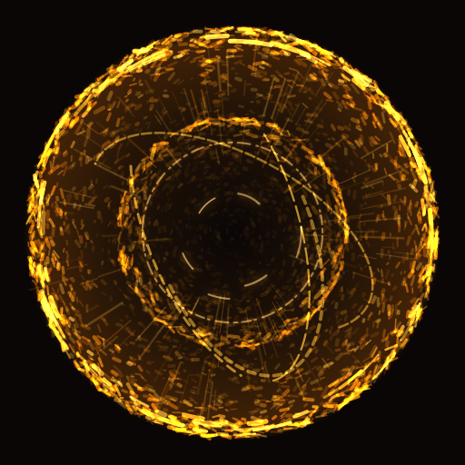
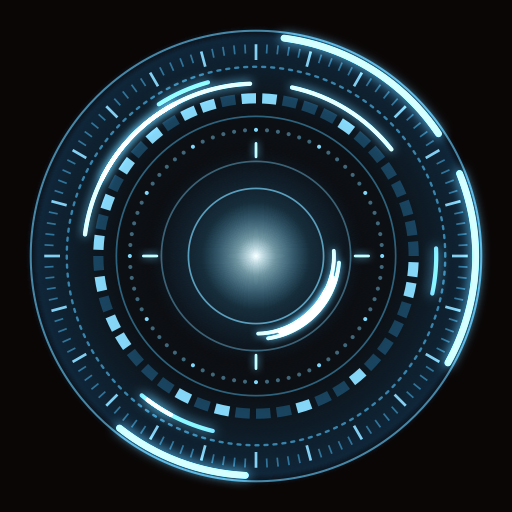

# OrbPet：桌面光球寵物

一個常駐在桌面上的光球桌寵，支援 **macOS 與 Windows**。有橙色光球和藍色光環兩種外觀，會呼吸、可以拖拽甩動，也有一些小互動。

> **給 AI 助手（Claude Code 等）：** clone 之後請先閱讀 [`CLAUDE.md`](CLAUDE.md)，照裡面的「幫使用者啟動」步驟操作。

> **本專案僅供個人娛樂與學習使用，非商業用途。**
> 詳見文末的[免責聲明](#免責聲明)。

 

---

## 快速開始

需求（macOS 和 Windows 都一樣）：

- [Git](https://git-scm.com)：用來下載專案。macOS 第一次執行 `git` 時，系統會提示你安裝；Windows 上安裝 Claude Code 時通常已經裝好了。
- [Node.js](https://nodejs.org) 18 以上，建議 LTS 版：用來安裝和執行程式。

```bash
git clone https://github.com/delio05/J.Pet.git
```

```bash
cd J.Pet
```

```bash
npm install
```

```bash
npm start
```

`npm install` 只需要第一次執行，會下載 Electron，大約 100 MB。之後每次只要 `npm start`。

### 用 Claude Code 啟動

在專案資料夾裡打開 Claude Code，對它說：

> 幫我安裝並啟動 OrbPet

Claude 會讀取 [`CLAUDE.md`](CLAUDE.md)，自動檢查 Node.js、安裝相依套件並啟動。之後想調整效果，也可以直接跟它說，例如「光球大一點」「拖拽手感輕一點」。

### 常見問題

| 狀況 | 處理方式 |
|---|---|
| `node: command not found` 或 `npm` 找不到 | 先到 https://nodejs.org 安裝 LTS 版，重新開終端機再試 |
| Windows PowerShell 出現「因為這個系統上已停用指令碼執行」 | 改用 `npm.cmd install` 和 `npm.cmd start`，或改用「命令提示字元」（cmd） |
| `npm install` 卡住，或下載 Electron 失敗 | 網路連不到 GitHub 時，可以改用鏡像站再試一次：macOS 執行 `ELECTRON_MIRROR=https://npmmirror.com/mirrors/electron/ npm install`，Windows PowerShell 執行 `$env:ELECTRON_MIRROR="https://npmmirror.com/mirrors/electron/"; npm.cmd install` |
| 找不到「J.」圖示 | macOS 在選單列右上角；Windows 在右下角系統匣，可能收在 `^` 裡 |
| 想關掉 | 「J.」圖示或光球右鍵 →「退出」 |
| 想重設設定 | 刪除設定檔：macOS 的 `~/Library/Application Support/orbpet/settings.json`；Windows 的 `%APPDATA%\orbpet\settings.json` |

---

## 功能

| 類別 | 內容 |
|---|---|
| 外觀 | 程式即時繪製的粒子光球（橙色）與 HUD 光環（藍色），右鍵「顏色」切換，會記住選擇 |
| 待機 | 依呼吸節奏縮放；外殼與光環慢速自轉 |
| 拖拽 | 拖動時朝前進方向變形並灑出碎片；放開可甩出，有重力、反彈、落地擠壓 |
| 互動 | 撫摸變亮、用力撞牆會頭暈、雙擊跳一下；2 秒內點 3 下會往旁邊躲一小步；橙色光球的小亮點會往滑鼠方向聚集 |
| 閒置 | 沒人理時只會東張西望，不移動；90 秒後先打個哈欠再睡著（右上角飄出 z z Z，不變暗）。睡著後滑鼠移動不會吵醒它，要點它、拖它或按右鍵才會醒，醒來會迷糊一下 |
| 自言自語 | 閒下來時偶爾在光球上方冒出一行字（例如「Standing by.」），每 5 到 10 分鐘最多一句；句子在 `pet.js` 開頭的 `LINES` |
| 你回來了 | 電腦解鎖或從睡眠恢復時亮一下；離開 5 分鐘以上會說「Welcome back.」 |
| 記得位置 | 下次啟動會出現在上次停留的地方 |
| 系統狀態 | CPU 越忙越紅、呼吸越快；低電量時變暗 |
| 番茄鐘 | 專注 25 分鐘、休息 5 分鐘，中央顯示七段數碼管倒數；計時中光球鎖定；結束時蹦跳，跳到最高點時爆出碎片 |
| 剪貼簿 | 複製東西時，碎片被吸進光球，接著光球「吞」一下並閃光（可關閉，不保存內容） |
| Claude Code | 終端機裡的 Claude Code 工作階段會顯示成光球上的分段弧線；做完、等你指示、要授權時跳出小視窗（見下方[和 Claude Code 連線](#和-claude-code-連線)） |
| 圖示 | macOS 選單列或 Windows 系統匣的「J.」：顯示或隱藏光球、番茄鐘、換色等；macOS 計時中會顯示剩餘時間 |

所有功能都**不需要任何系統權限**（不需要輔助使用、螢幕錄製、麥克風等）。

## 和 Claude Code 連線

有裝 [Claude Code](https://code.claude.com) 的話，OrbPet 一啟動就會自動接上，之後每個終端機裡的 Claude Code 工作階段都會出現在光球上（藍色在最外圈、橙色在第二圈，一個工作階段一段弧線）。沒裝 Claude Code 也完全不影響使用。

| 狀態 | 弧線 | 彈窗 |
|---|---|---|
| 工作中 | 亮線 | 沒有 |
| 等你指示／請求授權 | 一明一暗 | 有，點一下把對應的終端機 App 帶到前面 |
| 完成，還沒看 | 加粗亮線 | 有（8 秒後自己收起） |
| 已看過 | 暗線 | 沒有 |

運作方式與會動到的檔案：

- OrbPet 啟動時，如果找到 `~/.claude`，會在 `~/.claude/settings.json` 的 `hooks` 裡加上 6 個事件（`SessionStart`、`UserPromptSubmit`、`PostToolUse`、`Notification`、`Stop`、`SessionEnd`）。只會新增自己的項目，不動你原有的設定；第一次修改前會備份成 `settings.json.orbpet-backup`。
- hook 會執行 `~/.orbpet/orbpet-hook.sh`，把事件送到 OrbPet 在本機（`127.0.0.1`）開的連接埠。OrbPet 沒開時，這個腳本會立刻結束，不影響 Claude Code。
- 事件內容只留在記憶體裡用來顯示，不存檔、不外傳。不需要任何系統權限。
- 不想要的話：選單取消勾選「Connect to Claude Code」，會把上面加的 hooks 移除。
- 已經開著的 Claude Code 工作階段，會在它下一次有動作時出現。
- 點彈窗只會把終端機 App 帶到前面（tmux 會切到對應的 pane），還不能精準切到某一個分頁。
- 目前只支援 macOS／Linux；Windows 還沒做。

沒有開任何 Claude Code 工作階段時，光球上不會有弧線。

## 操作

| 動作 | 效果 |
|---|---|
| 拖拽、甩出 | 移動光球（番茄鐘計時中鎖定） |
| 雙擊 | 跳一下 |
| 滑鼠在球上來回滑 | 撫摸，光球變亮、微微顫動 |
| 滑鼠停在某一段弧線上 | 顯示那個 Claude Code 工作階段的專案名與狀態，弧線暫停轉動 |
| 右鍵，或點「J.」圖示 | 選單：隱藏光球、番茄鐘、系統狀態、顏色、剪貼簿反應、重力、回到中央、退出 |

## 自訂

參數集中在 `src/renderer/pet.js` 開頭，改完存檔，重新執行 `npm start` 即可：

- **`Cfg`**：外觀與物理，例如 `orbDiameter`（大小）、`gravity`、`floorRestitution`（彈性）、`dragStiffness`（拖拽跟手程度）、`throwScale`（甩出力道）。
- **`Behave`**：互動與行為，例如 `sleepAfter`、`focusMinutes`、`breakMinutes`、`dotGather`、`innerArcPeriod`、`brandText`（藍色光環中央文字）。

圖案本身（線條、顏色、圖形）在 `src/renderer/art.js`。改完可以執行 `npm run preview -- out.png`，輸出一張兩種主題的大張預覽圖。

## 專案結構

| 檔案 | 說明 |
|---|---|
| `src/main.js` | Electron 主程序：透明視窗、圖示、選單、游標、CPU、剪貼簿、設定 |
| `src/claude.js` | 和 Claude Code 連線：安裝 hooks、本機伺服器、工作階段狀態 |
| `src/preload.js` | 主程序與畫面之間的訊息通道 |
| `src/renderer/` | 畫面：`art.js` 負責圖案，`pet.js` 負責物理、互動和繪製，`sessions.js` 負責終端機弧線與彈窗 |
| `assets/` | Windows 系統匣圖示 |
| `tools/` | 預覽圖工具（`npm run preview`） |
| `legacy-swift/` | 舊版 macOS 原生實作（Swift），僅供參考 |
| `CLAUDE.md` | 給 Claude Code 的說明 |

## 已知限制

- 作者只在 macOS 上實際測試過；Windows 版使用相同的跨平台程式碼，但尚未實機驗證。遇到問題歡迎回報。
- Electron 版比原生版吃資源：平靜時大約佔 10% 到 15% 的單核 CPU、記憶體約 300 MB。

---

## 授權

程式碼以 [MIT License](LICENSE) 授權。這份授權只涵蓋本專案的程式碼，不包含任何第三方名稱或商標，請見下方免責聲明。

## 免責聲明

- 本專案為**個人娛樂與學習用途的非商業作品**，不販售、不收費、不用於任何商業推廣。
- 藍色光環主題中出現的「J.A.R.V.I.S.」文字僅作為致敬（fan tribute）。「J.A.R.V.I.S.」及相關角色名稱、標誌與商標屬於其各自的權利人（如 Marvel / The Walt Disney Company）。
- 本專案與上述權利人**沒有任何隸屬、授權、贊助或背書關係**，也不代表其官方產品。
- 本專案所有圖形皆由程式自行繪製，未使用任何官方素材。
- 若要公開散佈、商業使用，或將本專案用於公司產品，請先把 `Behave.brandText` 改成自己的名稱，並自行確認相關的法律風險。
- 本軟體依「現狀」提供，不附帶任何明示或默示的保證；使用本軟體所產生的任何後果由使用者自行承擔。
